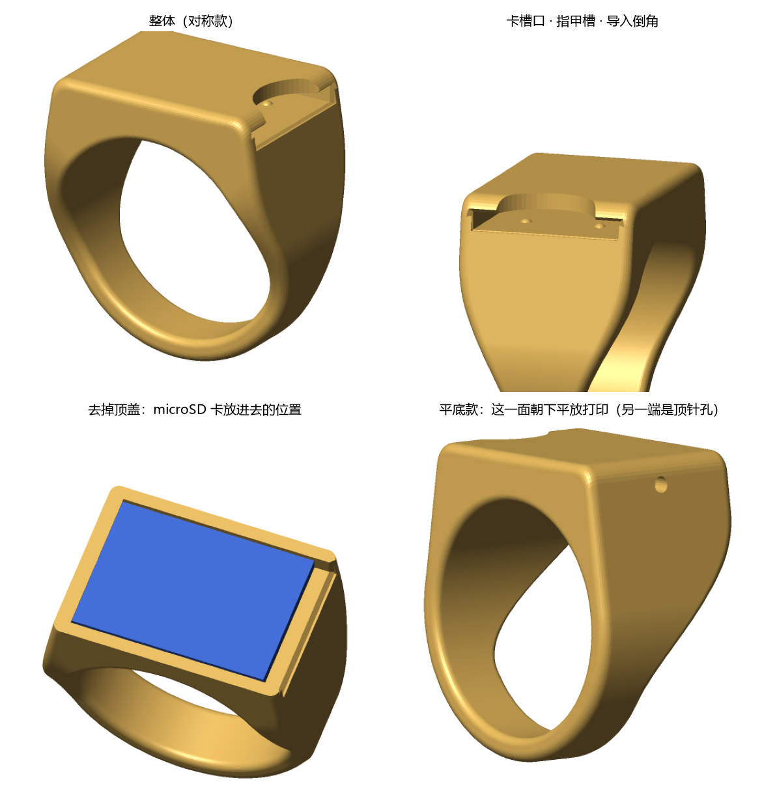
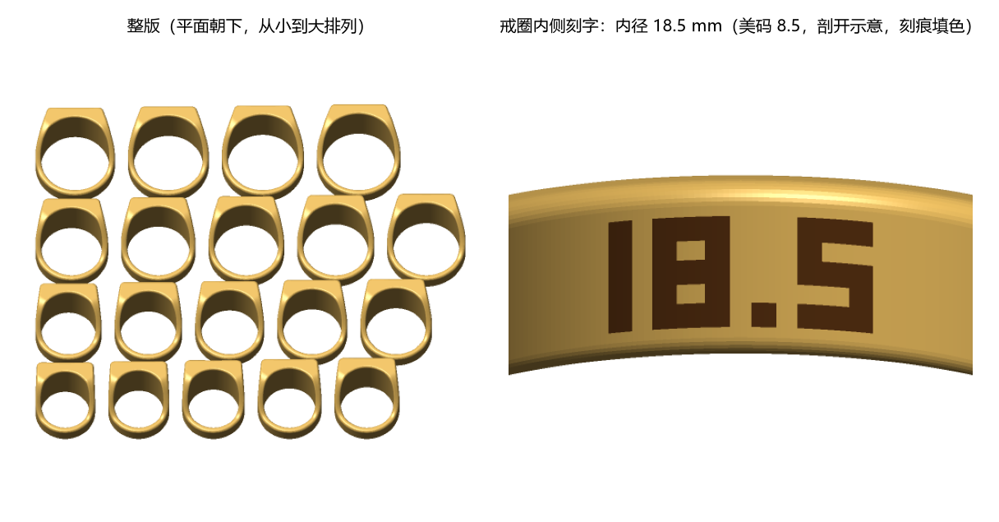

# SD Ring

A 3D-printable signet ring with a hidden **microSD card** slot. The card slides into the side of the head; a fingernail notch over the opening and a SIM-pin hole at the far end get it back out.

> **Just want to print it?** Download [`print this.stl`](print%20this.stl), open it in your slicer and print it as is: flat side down, no supports. It's all 19 ring sizes on one plate. Try them on and keep the one that fits.
>
> **只想打印？** 下载 [`print this.stl`](print%20this.stl)，用切片软件打开直接打印：平面朝下，不加支撑。它是一整版 19 个尺寸，打完逐个试戴，留下合适的那个。

[中文说明](#中文说明)



## What to print

1. **Find your size.** Print [`print this.stl`](print%20this.stl) (the same file as `stl/sizing_plate_US4-13.stl`): all 19 sizes (US 4–13, half sizes) on one plate, 133 × 111 mm, about 36 g of PLA. Each ring has its inner diameter engraved inside the band. Wear them and keep the one that slides over your knuckle with a little resistance and doesn't spin. The head is 13.4 mm wide, so it fits tighter than a thin band of the same size.
2. **Print your ring** from [`stl/rings/`](stl/rings), named by inner diameter and US size, e.g. `sd_ring_17.3mm_US7.stl`. These are the same rings as on the plate.

Already know your inner diameter? Skip step 1 and pick the closest file.



| Inner diameter (mm) | US | Circumference (mm) | ≈ HK/CN |
|---|---|---|---|
| 14.9 | 4 | 46.8 | 7 |
| 15.3 | 4.5 | 48.1 | 8 |
| 15.7 | 5 | 49.3 | 9 |
| 16.1 | 5.5 | 50.6 | 11 |
| 16.5 | 6 | 51.8 | 12 |
| 16.9 | 6.5 | 53.1 | 13 |
| 17.3 | 7 | 54.3 | 14 |
| 17.7 | 7.5 | 55.6 | 16 |
| 18.1 | 8 | 56.9 | 17 |
| 18.5 | 8.5 | 58.1 | 18 |
| 18.9 | 9 | 59.4 | 19 |
| 19.4 | 9.5 | 60.9 | 21 |
| 19.8 | 10 | 62.2 | 22 |
| 20.2 | 10.5 | 63.5 | 23 |
| 20.6 | 11 | 64.7 | 25 |
| 21.0 | 11.5 | 66.0 | 26 |
| 21.4 | 12 | 67.2 | 27 |
| 21.8 | 12.5 | 68.5 | 28 |
| 22.2 | 13 | 69.7 | 30 |

HK/CN sizes are approximate (circumference − 40).

## Print settings (FDM)

- The STLs are already oriented: **flat side down, no supports, no brim**.
- PLA, PLA+ or PETG. 0.12–0.16 mm layers keep the engraved numbers legible; 0.2 mm works but the numbers get rough.
- About 1.9 g and 3.55 mm tall above the finger. Head 17.7 × 13.4 mm, band 5 × 1.8 mm.
- Before the first insertion, clear any strings or blobs from the slot (pulling a strip of paper through works). Don't force a tight card.

## Inserting the card

Contacts go in **first, facing the top of the ring** (away from your finger). The two small retention bumps are on the finger side, so they only ever rub the label side. Push the card out with a SIM pin through the hole at the closed end, or drag it by its back edge under the notch.

Take the ring off for hot water, swimming or hand washing: the slot isn't sealed, and PLA starts to soften around 55–60 °C. Keep a backup of anything on the card.

## Status

**Not print-tested yet.** The slot clearance (0.35 mm on thickness) and the 0.25 mm retention bumps are calculated for FDM, not yet confirmed on a real print. If you print one, please open an issue with your printer, material and how the card fits.

## Custom sizes and variants

The STLs are generated by [`src/sd_ring.py`](src/sd_ring.py) (Python 3, tested on 3.12):

```bash
pip install -r requirements.txt
python src/sd_ring.py --inner-d 18.2        # one size: out/*_flat.stl (FDM) and *_signet.stl
python src/sd_ring.py --inner-d 18.2 --resin   # tighter clearances for resin printers
python src/sd_ring.py --detent 0            # no retention bumps, if the card is too tight
python src/sd_ring.py --set --us-range 6 10  # a smaller sizing plate
python src/sd_ring.py --set --out stl --no-preview   # rebuilds everything in stl/
```

`*_flat.stl` has one planar side for support-free FDM printing. `*_signet.stl` is symmetric: print it on resin, or on FDM with tree supports under the band.

---

## 中文说明

一个可以 3D 打印的印章戒指，戒面里藏着 **microSD 卡**槽。卡从戒面侧面插进去；取卡时用指甲在槽口上方的缺口处把卡拨出来，或者用手机取卡针从另一端的小孔把卡顶出来。

### 打哪个文件

1. **先确定尺寸**：打印 [`print this.stl`](print%20this.stl)（和 `stl/sizing_plate_US4-13.stl` 是同一个文件），一版包含 19 个尺寸（美码 4–13，每半号一个），133 × 111 mm，PLA 大约 36 g。每个戒指内侧刻着它的内径。逐个试戴，选能稍微用力推过指关节、戴上不转的那个。戒面下方有 13.4 mm 宽，所以会比同尺寸的细戒指紧一些。
2. **打印你的戒指**：在 [`stl/rings/`](stl/rings) 里找对应文件，按内径和美码命名，例如 `sd_ring_17.3mm_US7.stl`，和整版上的戒指完全一样。

已经知道自己的戒指内径的话，可以跳过第 1 步，直接选最接近的文件。尺寸对照见上面的表格（港码是近似值，约等于内周长 − 40）。

### 打印设置（FDM）

- STL 已经摆好方向：**平面朝下，不需要支撑，也不需要 brim**。
- PLA、PLA+ 或 PETG 都可以。层高 0.12–0.16 mm 时内侧数字清楚；0.2 mm 也能打，但数字会比较糊。
- 单个大约 1.9 g，戒面比手指高 3.55 mm。戒面 17.7 × 13.4 mm，戒圈 5 × 1.8 mm。
- 第一次插卡前，先把槽里的拉丝或残料清掉（拿一张纸条从槽里拉一遍就行）。卡太紧不要硬塞。

### 插卡方式

**金属触点朝前、朝戒面顶部**（远离手指）插进去。两个固定卡用的小凸点在靠手指的一侧，这样只会蹭到卡的标签面。取卡时用取卡针从封闭端的小孔顶，或者在缺口处拨卡的尾部。

洗手、游泳、碰热水时把戒指摘下来：卡槽不防水，PLA 在 55–60 °C 左右就开始变软。卡里的重要数据记得另外备份。

### 状态

**还没有实际打印验证过。** 卡槽间隙（厚度方向 0.35 mm）和 0.25 mm 的固定凸点是按 FDM 计算的，还没在实物上确认。如果你打印了，欢迎开 issue 说一下用的打印机、材料，以及卡插进去的松紧。

### 自定义尺寸

所有 STL 都由 [`src/sd_ring.py`](src/sd_ring.py) 生成，命令见上面英文部分的 “Custom sizes and variants”。常用的：`--inner-d 18.2` 生成指定内径，`--resin` 用于光固化打印机（间隙更小），`--detent 0` 去掉固定凸点（卡太紧时用）。
